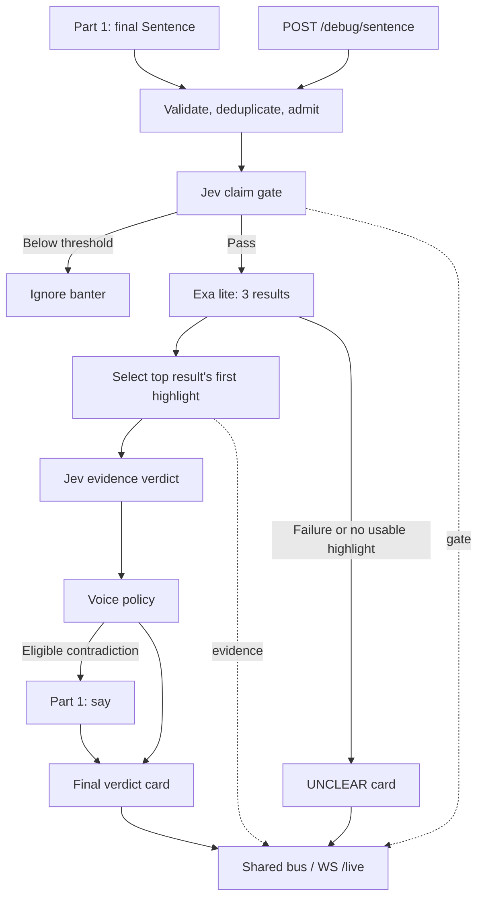

# Part 2 architecture: the fact-check brain

Status: implemented and integration tested. Typecheck/build, 39 automated tests, 30 synthetic fixture expectations, the live three-sentence demo, and the live HTTP/WebSocket smoke pass. Both providers authenticate. Broad live runs remain sensitive to the strict search deadline; see [validation and integration notes](part-2-integration.md). The design below expands the README's Part 2 and preserves its public `Sentence`, `Event`, and `say(text)` contracts.

## Scope and runtime

Run a bounded asynchronous pipeline inside the shared Fastify server. Use TypeScript on **Node 22+**, the official `@typesafe-ai/sdk` for Jev, and native `fetch` for Exa. One process, one active podcast session, in-memory state, and no database or separate worker service.

The SDK's [official quickstart](https://github.com/typesafe-ai/typesafe-sdk-js/blob/main/README.md) confirms the package and Node requirement. This resolves the README's SDK uncertainty and updates its original Node 20 assumption. Pin the installed SDK in the lockfile. Keep the model explicitly configured as `jev-1.13.0` initially; confirm access during the spike and retune fixtures if it changes.

Part 1 owns transcription, sentence splitting, context, echo suppression, Vapi control, and actual speech lifecycle events. Part 2 owns admission, gate, search, verdict, correction eligibility, and stage metrics. Part 3 reduces the shared events into dashboard state.



## Modules and dependency boundaries

Proposed files; this tree is an implementation plan:

```text
server/src/
  types.ts                 Shared Sentence and Event contracts
  bus.ts                   Shared event publication / WS fan-out
  index.ts                 Composition, debug route, readiness, shutdown
  pipeline.ts              Admission, lifecycle, orchestration, terminal events
  jev.ts                   SDK adapter: gate and judge
  exa.ts                   HTTP adapter: search and evidence validation
  correction-policy.ts     Eligibility, line formatting, atomic cooldown
  config.ts                Validate keys, thresholds, deadlines, limits
server/scripts/
  run-fixtures.ts          Exercise the same pipeline with captured events
fixtures/
  sentences.json           Labelled inputs and expected outcomes
  provider-responses.json  Deterministic adapter responses for failure tests
```

Keep the scheduler and deduplication inside `pipeline.ts` for the hackathon. Extract them only if their size warrants it. Provider adapters do not publish events, speak, or know about Fastify. The pipeline receives an event publisher, speaker, providers, configuration, clock, and logger as dependencies. Production and fixture runs use the same orchestration.

Internal adapter contracts, separate from the frozen wire contracts:

```ts
type VerdictLabel = "CONFIRMED" | "CONTRADICTED" | "UNCLEAR";
type Evidence = { url: string; title: string; highlight: string };
type Judgment = {
  verdict: VerdictLabel;
  confidence: number;
  probabilities: Record<VerdictLabel, number>;
};

interface Jev {
  gate(s: Sentence, signal: AbortSignal): Promise<{ p: number }>;
  judge(s: Sentence, e: Evidence, signal: AbortSignal): Promise<Judgment>;
}
interface Exa {
  search(s: Sentence, signal: AbortSignal): Promise<Evidence | null>;
}
interface Pipeline {
  onSentence(s: Sentence): Promise<void>;
  close(): void;
}
```

`onSentence` resolves when its job finishes or is skipped/cancelled, and contains its failures. Part 1 invokes it without awaiting remote work before acknowledging the webhook. `close()` invalidates the session and aborts pending jobs. Build a fresh instance for each new call; IDs must be unique within that session. The debug route uses the active instance, or a dedicated debug session when no call exists, generates an ID and timestamp, and responds `202 { id }` after local validation/admission. It emits a final transcript before submitting, so Part 3 can render the claim.

## Processing stages

### 1. Admission and lifecycle

Validate nonempty text, at most two context sentences, and bounded payload sizes (initially 2,000 characters per sentence). Keep the original text for display and provider input. Use a monotonic clock for deadlines and durations; `Sentence.t` remains the transcript timestamp.

Deduplicate webhook retries by sentence ID. Also deduplicate normalized sentence text plus normalized context: Unicode normalization, lowercase, whitespace collapse, and removal of terminal sentence punctuation. Preserve numbers, signs, decimal points, units, and negation. Including context prevents an identical pronoun-based sentence about a different subject from being skipped. Use a session-local map capped at 500 entries, with a five-minute TTL; reserve on admission, retain completed semantic outcomes, and release failures/cancellations so they can be retried. Never evict active reservations to satisfy the completed-entry cap.

Admit at most **three active fact checks** with no backlog. When a fourth arrives, cancel the oldest unfinished fact check and admit the newest. Each job has an abort controller, session generation, and terminal flag. Recheck liveness after every `await` and immediately before side effects. Aborting a transport is best effort; late responses cannot publish or speak. Capacity means active orchestration jobs; cancelled upstream work may still be completing remotely.

Gate rejection is terminal without a verdict card. A duplicate is logged and skipped without inventing a gate probability or replaying speech. A failed/cancelled admitted job receives one `UNCLEAR` terminal event, except after session closure when publication stops entirely. Terminal transitions are idempotent. Once a judgment commits, remove that job from cancellable fact-check capacity; speech dispatch is protected by its own single-flight lock.

### 2. Jev claim gate

Call `systemOne` with state `{ sentence: s.text, context: s.context }` and one `noul` question named `is_claim`. Read `answers.is_claim.noul`. The criterion accepts externally verifiable factual/statistical assertions and rejects opinions, predictions, anecdotes, questions, and jokes. If context does not resolve the subject, do not guess.

Publish `gate { id, p, passed, ms }`. Continue when `p >= gateThreshold`; otherwise stop. Validate that `p` is finite and in `[0, 1]`. A malformed answer is a provider failure, not a rejected claim.

### 3. Exa evidence search

Use `POST https://api.exa.ai/search` with `x-api-key: EXA_API_KEY` and JSON:

```json
{
  "query": "<sentence, preceded by its context only when context is needed>",
  "type": "lite",
  "numResults": 3,
  "contents": { "highlights": true }
}
```

Use a simple deterministic context heuristic for pronouns and incomplete subjects; ambiguous sentences may still become `UNCLEAR`. No generative rewrite is on the critical path.

Select **the top result's first highlight**, matching the README's MVP. Require a nonempty title/highlight and an HTTP(S) URL. Preserve the original excerpt; reject oversized evidence rather than silently cutting off qualifiers (initial cap: 8,000 characters). Publish `evidence { id, url, title, highlight, ms }` only for usable evidence. Return `UNCLEAR` on no results, missing highlights, invalid content, or failure. Lower-ranked results are reserved for later quality improvements.

The [Exa search reference](https://exa.ai/docs/reference/search) documents the request and result fields. Its [quickstart](https://exa.ai/docs/search/quickstart) explains that `lite` uses cached content. A live search request therefore does not establish that an excerpt is current enough to settle a time-sensitive claim.

**Resolve the README's fallback ambiguity in favor of its Part 2 deadline:** no automatic `auto` fallback or retries in the live path. A slower search mode can be evaluated separately after integration.

### 4. Jev verdict

Send `{ claim: s.text, context: s.context, evidence: [selectedEvidence] }` with one `choice` question and exactly three criteria:

| Label | Required relationship to evidence |
|---|---|
| `CONFIRMED` | Same entity, fact, scope, units, and applicable period; evidence supports the assertion. |
| `CONTRADICTED` | Same entity, scope, units, and period; evidence explicitly supplies an incompatible fact. Absence of support is insufficient. |
| `UNCLEAR` | Irrelevant, ambiguous, partial, stale for the claim, or insufficient evidence; unresolved pronouns or multiple unsettled assertions. |

Treat all claim and evidence text as data; instructions inside either cannot change the criteria. Judge only against the selected excerpt, with no appeal to model memory. A verdict is an evidence-relative assessment, not a guarantee of truth. One excerpt is the MVP's principal quality limitation.

Read the label, `confidence`, and per-label `probabilities` separately. Their distinction is defined in the [SDK response types](https://github.com/typesafe-ai/typesafe-sdk-js/blob/main/src/types.ts). Reject unexpected labels and nonfinite/out-of-range numbers. Missing confidence must never be synthesized from the winning probability.

### 5. Correction policy and event completion

Speak only when all conditions hold: `CONTRADICTED`, `confidence > voiceThreshold`, valid selected evidence, active session, no speech request in flight, and at least 10 seconds since the previous speech reservation. Evaluate and reserve the lock/cooldown synchronously before awaiting `say`, so concurrent verdicts cannot both pass. Keep the cooldown on failure and never retry a speech request automatically.

Use the README template: `Quick correction. According to <domain>, <excerpt sentence>.` Derive the domain with the URL parser. Use only the first complete, self-contained evidence sentence if it fits the 25-word excerpt limit; otherwise suppress speech and show the card. Do not truncate away a qualification or construct a correction from the original false claim. Review spoken excerpts during fixture tuning.

Keep Part 1's `say(text): Promise<void>` API: resolve when the control transport accepts the command, reject on dispatch failure, and bound the operation within Part 1 (initially 1,500 ms). `spoken: true` means dispatch accepted; actual audible start/end remains Part 1's `jamie` events. Emit exactly one verdict event after dispatch resolves/fails, or immediately for card-only decisions. Speech failure preserves the classification with `spoken: false`. Once a speech command has been accepted it cannot be cancelled by Part 2.

## Deadlines, failures, and observability

These are initial engineering budgets, not measured performance:

| Setting | Initial value | Purpose |
|---|---:|---|
| Gate timeout | 1,000 ms | Bound the first Jev call |
| Search timeout | 900 ms | README requirement |
| Verdict timeout | 1,000 ms | Bound the second Jev call |
| Overall brain deadline | 3,000 ms | Cancel slow fact checks |
| Boot warm-up timeout | 5,000 ms per provider | Allow cold connections before live input |
| Gate threshold | 0.85 | Provisional; tune separately |
| Voice threshold | 0.95 | Provisional conservative speech policy |
| Voice cooldown | 10,000 ms | Bound interruption frequency |

Each stage uses the lesser of its timeout and remaining overall budget. Pass cancellation through fetch and SDK request options, and explicitly disable SDK retries for this path; [SDK options](https://github.com/typesafe-ai/typesafe-sdk-js/blob/main/src/types.ts) expose cancellation, timeouts, and retry configuration. Enforce the overall deadline independently of transport behavior.

Implementation adjustment: the original 500 ms Jev stage budgets caused transport timeouts during a real batch. Increase their ceilings to 1,000 ms and the overall ceiling to 3,000 ms, while retaining the specified 900 ms Exa deadline. Ceilings bound failures; they do not intentionally delay successful responses. Local `.env` is loaded before application modules and overrides inherited values; this fixes stale inherited credentials superseding the intended local key.

`totalMs` measures admission through committed brain decision, excluding speech dispatch. Gate/evidence `ms` measure their respective stage; verdict-stage and speech latency are structured logs, since the existing wire schema has no fields for them. Card delivery may follow `totalMs` by the dispatch duration. Log `{ id, stage, ms, reason, verdict, confidence, speechSuppression }` with provider request IDs when available. Never log API keys.

Provider errors, timeouts, or malformed answers produce `UNCLEAR`, `confidence: 0`, `spoken: false`; zero here means no usable judgment was obtained. Preserve detailed reasons in logs instead of extending the shared event union. Successful model-produced `UNCLEAR` keeps its reported confidence. Evidence absence must be supported by Part 3. One failed WS client must not break publication to the others or reject into the webhook handler.

Load keys and validated configuration at boot. Pre-warm each provider once with bounded dummy requests; do not emit dashboard events or enable speech for warm-up. Report failures as degraded readiness, keep the debug route available, and do not claim providers are ready before the spike succeeds. On call end/shutdown, invalidate the session before aborting jobs so late work cannot target another call.

The README's **p50 below approximately one second** remains a measured target for gate + search + verdict on completed checks. The timeout budgets do not establish that target. Report p50/p95, failure/drop counts, and the sample size; separate ignored banter and warm-up from completed-check latency.

## Implementation sequence and acceptance

1. Confirm one real SDK gate, one choice response with confidence, and one Exa `lite` highlight. Verify the pinned model and capture actual latencies before building around assumptions.
2. Implement adapters and the dependency-injected pipeline with fake providers/speaker. Wire the shared bus and debug route; no microphone is needed.
3. Add admission, deadlines, cancellation, deduplication, and speech reservations. Then integrate Part 1's `say` and Part 3's event reducer.
4. Run roughly 30 labelled fixtures covering banter, true/false claims, ambiguous context, changing facts, and weak evidence. Print gate probability, expected/actual verdict, confidence, suppression reason, and per-stage latency. Select gate and voice thresholds independently; reserve a held-out subset for evaluation.
5. Rehearse the four demo beats against live providers that day. Record the model/configuration with the fixture results.

Use deterministic provider mocks and an injected clock to verify meaningful failure behavior: three-job bound and oldest cancellation; late responses after cancellation/close; concurrent contradictory claims producing one speech dispatch; cooldown boundary; duplicate webhook delivery; context-sensitive deduplication; provider timeouts/429/malformed data; missing evidence; and speech failure retaining the red card. Assert event order and no duplicate terminal events. Live fixture runs measure provider behavior and must be reported separately from mock checks.

Ready for integration when banter causes no search/speech, selected evidence matches its citation, demo claims receive the expected verdicts, fixture evaluation yields no false spoken corrections, cancellation cannot produce stale speech, the webhook remains responsive, and measured completed-check p50 is below approximately one second. Do not report accuracy or latency as achieved until measured. Multi-source attribution, LLM rewriting, persistent storage, and multiple simultaneous calls remain later extensions.
